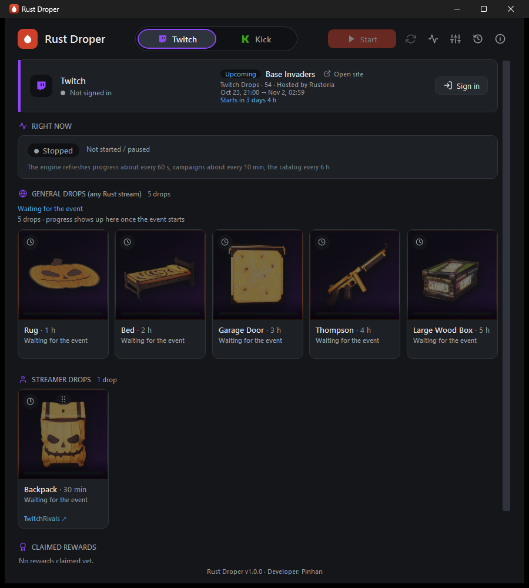
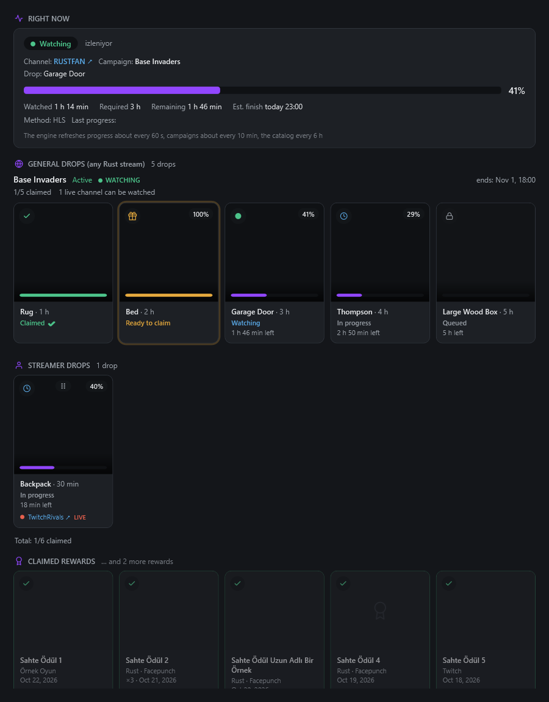
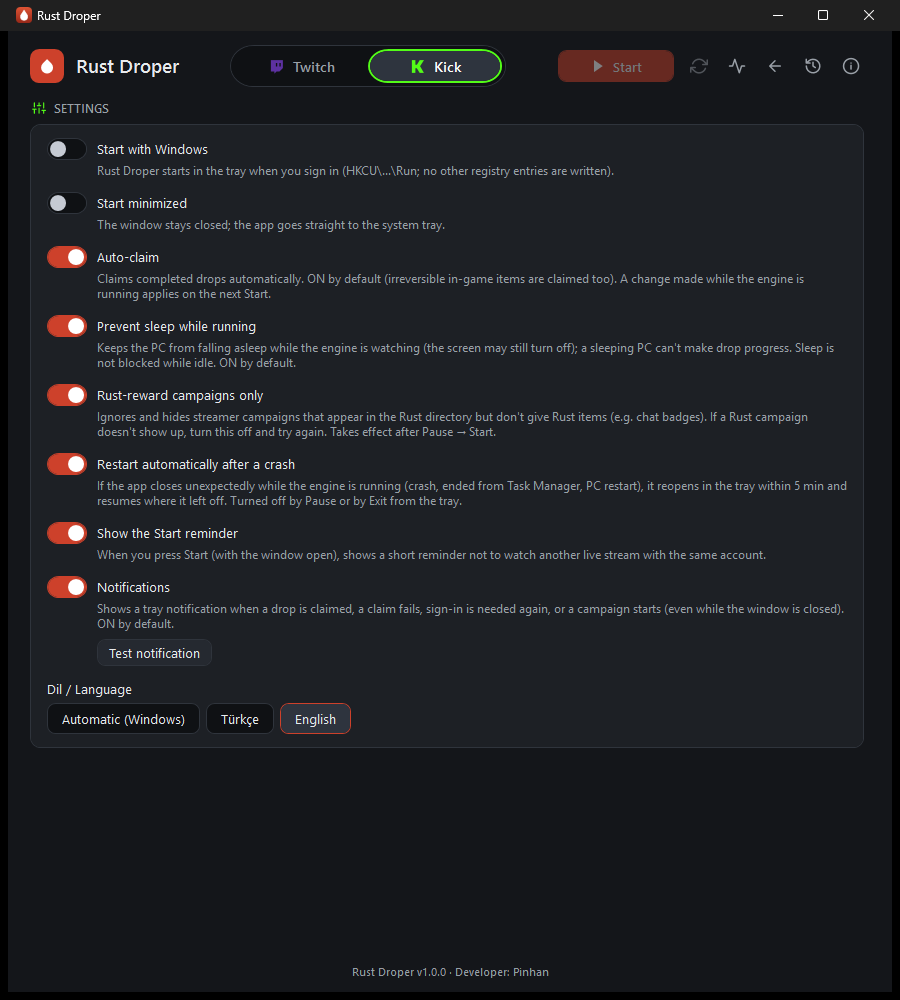
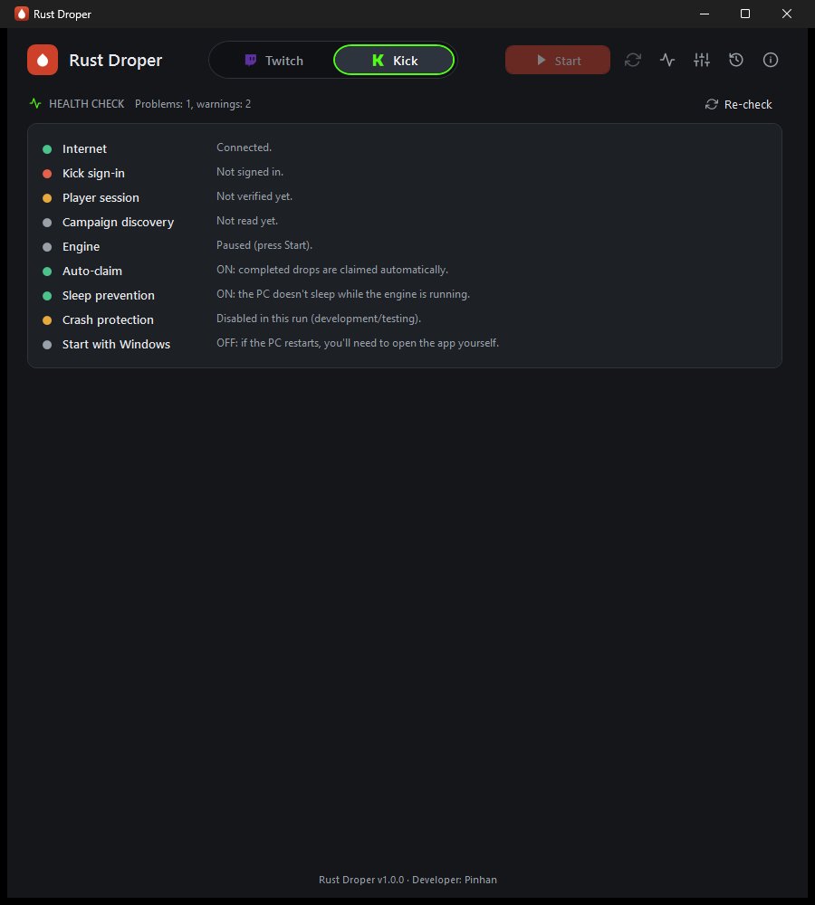

# Rust Droper

**Collects Rust Twitch and Kick drops in the background, from the system tray.**

[Türkçe](README.tr.md) · [Download](../../releases/latest) · [Changelog](CHANGELOG.md) · [Usage guide](docs/USAGE.md) · [License: MIT](LICENSE)

> [!IMPORTANT]
> ### ⬇️ How to download and run
> 1. Open the **[Releases page](https://github.com/Pinhan/Rust-Droper/releases/latest)**.
> 2. Under **Assets**, download **`RustDroper-<version>-win-x64.zip`**.
> 3. Unzip it anywhere and double-click **`RustDroper.exe`** (no installer).
>
> ⚠️ Do **not** use the green **Code → Download ZIP** button or the *"Source code (zip)"* files: those are only the program's source code and contain **no `.exe`**.


Rust Droper is a small Windows tray app for the [Rust](https://rust.facepunch.com/) *Twitch Drops* and *Kick Drops* events. You sign in once; it then follows the active Rust campaigns, keeps a suitable stream "watched" for you, shows progress and claims finished rewards. Rust only — no other game.



> [!WARNING]
> **Read this first.**
> - Twitch's and Kick's terms of use may restrict automation. A warning or restriction on your account is **possible**; you use Rust Droper **at your own risk**. There is no guarantee of any kind (see [LICENSE](LICENSE)).
> - Rust Droper is an **independent project**. It is **not affiliated with, endorsed by or sponsored by** Twitch, Kick, Facepunch Studios or Rust. All names and trademarks belong to their owners.
> - **Honest status:** automatic claiming is verified against Twitch's live API for Twitch-native rewards (badges/emotes). Claiming *game-delivered* Rust items (the Steam/Facepunch kind) is **only just being tested on a real Rust campaign** — a fallback ("claim it manually" notification + link) exists, but expect rough edges in the first days. Kick drop progress is verified live; Kick claiming has not been tested live yet.
> - Auto-claim also claims irreversible in-game items. It is on by default and can be turned off in Settings.

## Features

- Follows Rust's **Twitch and Kick** drop campaigns automatically (general drops and streamer drops).
- **Quiet:** Twitch is watched through the real stream feed at the lowest quality (no browser window, about 2 MB/min); Kick uses a hidden, muted browser player (WebView2).
- A separate screen per platform with a Twitch ⇄ Kick switch; drop cards with images, progress and states (queued, watching, ready to claim, claimed).
- **Auto-claim** and a "claimed rewards" section; drag-and-drop **priority order** for streamer drops.
- **Health check** page (internet, sign-in, Facepunch/Steam link, campaign discovery, engine, sleep prevention…).
- Tray icon, notifications, **crash recovery**, recovery after internet outages and PC sleep, optional sleep prevention.
- **Turkish and English** interface (automatic from the Windows language, switchable instantly).
- Portable single `.exe`, no installer, no .NET install needed. Sign-in data stays on your PC, encrypted with Windows DPAPI. **No telemetry.**

| Drop cards (sample data) | Settings | Health check |
|---|---|---|
|  |  |  |

## Download

Get `RustDroper-<version>-win-x64.zip` from the **[Releases page](../../releases/latest)**, unzip it anywhere and run `RustDroper.exe`. Requirements: Windows 10/11, 64-bit. The Kick player needs the Microsoft Edge **WebView2 Runtime** (already present on current Windows 10/11).

### SmartScreen / antivirus notice

The executable is **not code-signed**, so Windows SmartScreen may show "Windows protected your PC" (*More info → Run anyway*), and a few antivirus products may flag a tray app that automates a website. This is a common false positive for unsigned, self-contained, automation-style tools. You do not have to trust the binary:

- **Verify the download:** every release has a `SHA256SUMS.txt`. In PowerShell: `Get-FileHash .\RustDroper-1.0.0-win-x64.zip -Algorithm SHA256` and compare.
- **Build it yourself** from source (below) — the build is the same one the release workflow runs ([`.github/workflows/release.yml`](.github/workflows/release.yml)).
- The code is open (MIT); the app only talks to Twitch, Kick and Facepunch sites.

## Quick start

1. **Link Steam ↔ Twitch** once at <https://twitch.facepunch.com/connect> (needed for Rust items to reach your Steam inventory).
2. Run `RustDroper.exe`. In the **Twitch** card press **Sign in**: a code is shown; the browser opens `twitch.tv/activate` — enter the code there. Your password is never typed into Rust Droper.
3. *(Optional)* **Kick:** press **Sign in**, scan the QR code with the **Kick phone app**; then press **Player sign-in** once and sign in to kick.com in the window that opens.
4. Check **Auto-claim** in Settings (on by default), open the **Health check** (pulse icon) and press **Start**.
5. Closing the window sends the app to the tray. Right-click the tray icon for **Start/Pause** and **Exit**.

More detail: [docs/USAGE.md](docs/USAGE.md).

## How it works (short)

- **Discovery:** campaigns are read from Twitch's GraphQL API and Kick's public API; only campaigns that give Rust rewards are followed.
- **Watching:** the server counts watch time per account, for one channel at a time. Twitch: the app requests the stream's HLS playlist and segments like a player (lowest quality) — no browser. Kick: a hidden WebView2 player, because Kick only credits the real player.
- **Truth comes from the server:** progress is reconciled with Twitch's `Inventory`/`DropCurrentSession` and Kick's progress endpoints; a watchdog switches channels when progress stalls.
- **Claim:** Twitch PubSub `drop-claim` events, with a fallback that builds the claim ID itself; Kick via its claim endpoint.
- Details: [architecture](docs/02-mimari.md), [platform notes](docs/PLATFORM-NOTES.md), [Kick risk research](docs/04-kick-risk-arastirmasi.md), [UI design](docs/05-arayuz-tasarimi.md), [simultaneous watching / multi-account research](docs/06-arastirma-eszamanli-izleme-ve-coklu-hesap.md). *(Several design documents are in Turkish.)*

Rust Droper was designed after studying how other open-source drop miners behave (TwitchDropsMiner, TwitchDropsBot, StreamDropCollector). **No code was copied from them**; they are credited as inspiration/analysis in [THIRD-PARTY-NOTICES.md](THIRD-PARTY-NOTICES.md).

## FAQ

**Does it need my password?** No. Twitch uses the device-code flow on twitch.tv; Kick uses a QR login with the Kick phone app plus a normal sign-in in a WebView2 window. Tokens are stored encrypted (DPAPI) on your PC only and are masked in logs.

**Can I use it while gaming/streaming?** Yes, but do not watch another live stream **with the same account** while it runs (browser or app) — drop progress can break. The app reminds you when you press Start.

**Why is my PC kept awake?** A sleeping PC cannot make drop progress. "Prevent sleep while running" (on by default) can be turned off. The screen may still turn off.

**How much does it use?** About 60 MB of RAM in the tray with Twitch only. Kick runs a hidden browser (WebView2): expect roughly 0.6–0.8 GB RAM and a fraction of one CPU core while Kick is active.

**Nothing is being watched ("Idle").** There may be no active Rust campaign or no Drops-Enabled live Rust stream yet; it re-checks every few minutes. Check the **Health check** page and the logs (About → *Open logs folder*).

**"Schema may have changed" / degraded mode.** Twitch occasionally rotates internal API identifiers; the app retries with backoff. Please open an issue with the version and log lines if it persists.

**Where is my data?** `%LOCALAPPDATA%\RustDroper` (settings, logs, encrypted sign-in). To start clean, close the app and delete that folder. For testing you can point `RUSTDROPER_DATA` at another folder.

**Is it safe to run?** The source is here; build it yourself if you prefer. The risk that matters is the platform-terms risk described above.

**Will you add other games / multiple accounts?** Rust only, one Twitch + one Kick account, by design (lower risk, simpler).

## Build from source

Requirements: Windows, [.NET 10 SDK](https://dotnet.microsoft.com/download/dotnet/10.0).

```powershell
dotnet build RustDroper.slnx -c Release     # 0 warnings expected (warnings are errors)
dotnet test  RustDroper.slnx -c Release     # unit + UI tests (live/network tests are skipped by default)
powershell -File build\publish-portable.ps1 # -> publish\RustDroper\RustDroper.exe (self-contained, single file, ~127 MB)
```

Notes: tests marked *live* only run with `RUSTDROPER_LIVE=1` and need real network access/accounts — they are skipped normally. Tests that need WebView2 and an interactive desktop are skipped when `RUSTDROPER_SKIP_WEBVIEW2=1` (this is what CI sets). The solution is `RustDroper.slnx` (`src/` = Core, App, Cli; `tests/` = Core.Tests, App.Tests).

## Contributing & support

Support is **best-effort**: this is a hobby project, there is no guarantee of response time. Please read [CONTRIBUTING.md](CONTRIBUTING.md) (open an issue first; every user-visible change needs a Turkish + English changelog entry and a Semantic Versioning bump — see [docs/08](docs/08-surum-ve-degisiklik-kaydi.md)). Security issues: see [SECURITY.md](SECURITY.md). Contact: thepinhan@gmail.com (GitHub Issues preferred).

## License

[MIT](LICENSE) © 2026 Pinhan. Third-party components: [THIRD-PARTY-NOTICES.md](THIRD-PARTY-NOTICES.md).
