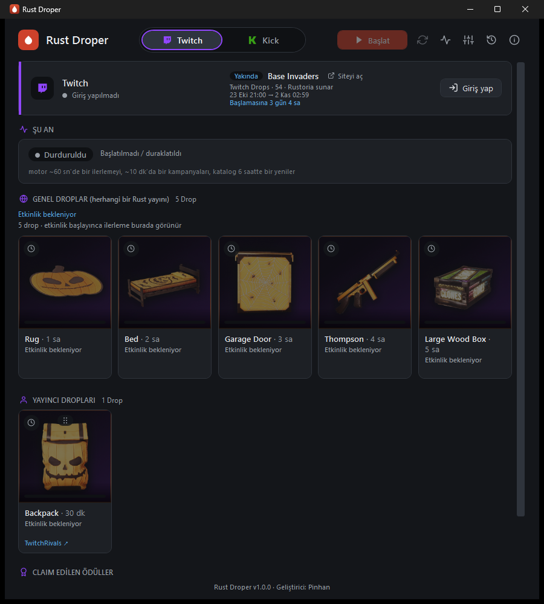
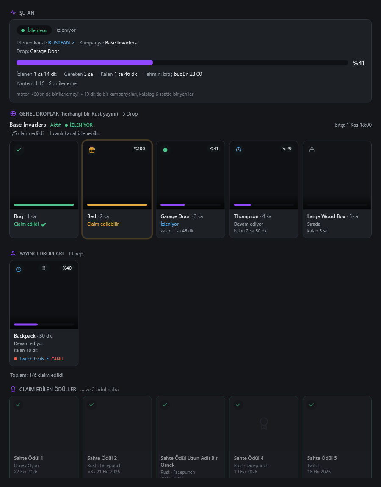
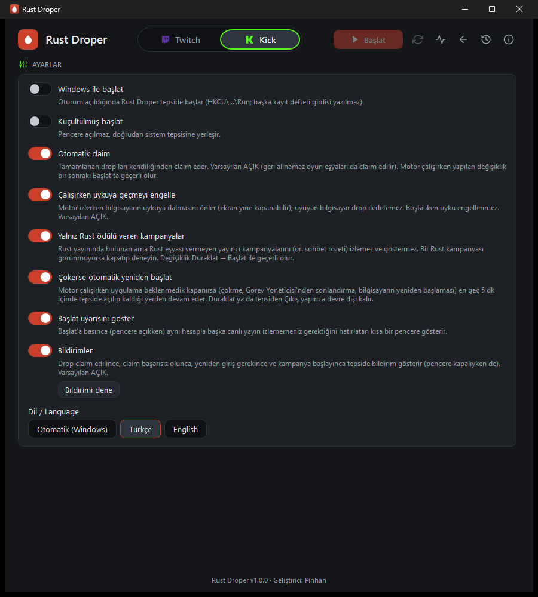
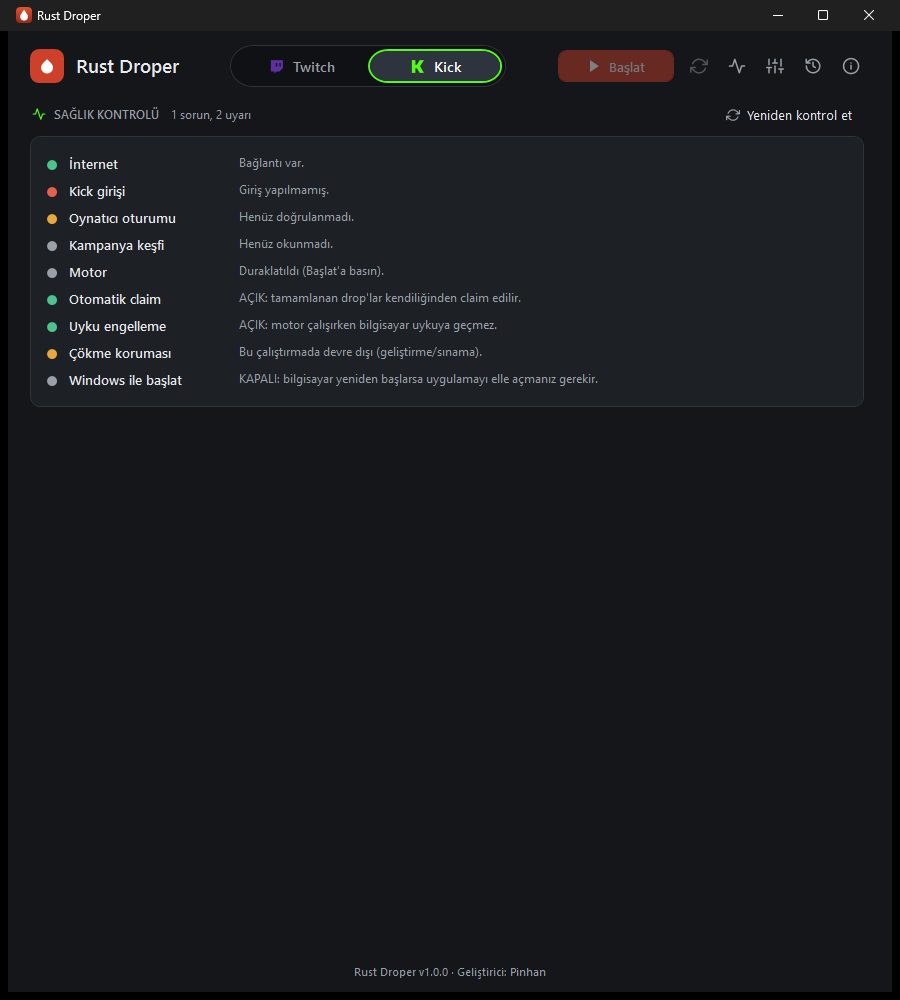

# Rust Droper

**Rust'ın Twitch ve Kick drop'larını sistem tepsisinden, arka planda toplar.**

[English](README.md) · [İndir](../../releases/latest) · [Değişiklik günlüğü](CHANGELOG.tr.md) · [Kullanım kılavuzu](docs/USAGE.tr.md) · [Lisans: MIT](LICENSE)

Rust Droper, [Rust](https://rust.facepunch.com/) oyununun *Twitch Drops* ve *Kick Drops* etkinlikleri için küçük bir Windows tepsi uygulamasıdır. Bir kez giriş yaparsınız; uygulama aktif Rust kampanyalarını takip eder, sizin yerinize uygun bir yayını "izler", ilerlemeyi gösterir ve tamamlanan ödülleri claim eder. Yalnızca Rust — başka oyun yok.



> [!WARNING]
> **Önce bunu okuyun.**
> - Twitch ve Kick kullanım koşulları otomasyonu kısıtlıyor olabilir. Hesabınızda uyarı veya kısıtlama **olabilir**; Rust Droper'ı **kendi sorumluluğunuzda** kullanırsınız. Hiçbir garanti yoktur ([LICENSE](LICENSE)).
> - Rust Droper **bağımsız bir projedir**; Twitch, Kick, Facepunch Studios veya Rust ile **bağlantılı değildir, onlarca onaylanmamış ve desteklenmemiştir**. Tüm ad ve markalar sahiplerine aittir.
> - **Dürüst durum:** otomatik claim, Twitch'e özgü ödüllerde (rozet/emote) Twitch'in canlı API'siyle doğrulandı. *Oyuna teslim edilen* Rust eşyalarının (Steam/Facepunch türü) claim'i gerçek bir Rust kampanyasında **yeni sınanıyor** — yedek yol ("elle claim et" bildirimi + bağlantı) hazır, ama ilk günlerde pürüz bekleyin. Kick'te drop ilerlemesi canlıda doğrulandı; Kick claim'i henüz canlıda sınanmadı.
> - Otomatik claim, geri alınamaz oyun eşyalarını da claim eder. Varsayılan olarak açıktır; Ayarlar'dan kapatılabilir.

## Özellikler

- Rust'ın **Twitch ve Kick** drop kampanyalarını (genel ve yayıncı drop'ları) kendiliğinden takip eder.
- **Sessiz:** Twitch gerçek yayın akışıyla en düşük kalitede izlenir (tarayıcı penceresi yok, ~2 MB/dk); Kick gizli, sessiz bir tarayıcı oynatıcısıyla (WebView2) izlenir.
- Her platform için ayrı ekran ve Twitch ⇄ Kick geçişi; görselli drop kartları, ilerleme ve durumlar (sırada, izleniyor, claim'e hazır, claim edildi).
- **Otomatik claim**, "claim edilen ödüller" bölümü; yayıncı drop'ları için sürükle-bırak **öncelik sırası**.
- **Sağlık kontrolü** sayfası (internet, giriş, Facepunch/Steam bağlantısı, kampanya keşfi, motor, uyku engelleme…).
- Tepsi simgesi, bildirimler, **çökme kurtarma**, internet kesintisi/bilgisayar uykusu sonrası toparlanma, isteğe bağlı uyku engelleme.
- **Türkçe ve İngilizce** arayüz (Windows diline göre otomatik, anında değiştirilebilir).
- Taşınabilir tek `.exe`; kurulum ve .NET kurulumu gerekmez. Oturum bilgileriniz bilgisayarınızda Windows DPAPI ile şifreli kalır. **Telemetri yok.**

| Drop kartları (örnek veri) | Ayarlar | Sağlık kontrolü |
|---|---|---|
|  |  |  |

## İndirme

**[Releases sayfasından](../../releases/latest)** `RustDroper-<sürüm>-win-x64.zip` dosyasını indirin, istediğiniz klasöre çıkarın ve `RustDroper.exe`'yi çalıştırın. Gereksinim: Windows 10/11, 64 bit. Kick oynatıcısı için Microsoft Edge **WebView2 Runtime** gerekir (güncel Windows 10/11'de hazır gelir).

### SmartScreen / antivirüs notu

Çalıştırılabilir dosya **kod imzalı değildir**; bu yüzden Windows SmartScreen "Windows bilgisayarınızı korudu" uyarısı gösterebilir (*Ek bilgi → Yine de çalıştır*) ve birkaç antivirüs, bir web sitesini otomatikleştiren tepsi uygulamasını şüpheli bulabilir. İmzasız, kendi içinde çalışma zamanını taşıyan, otomasyon tarzı araçlarda sık görülen bir yanlış alarmdır. İkili dosyaya güvenmek zorunda değilsiniz:

- **İndirmeyi doğrulayın:** her sürümde `SHA256SUMS.txt` vardır. PowerShell: `Get-FileHash .\RustDroper-1.0.0-win-x64.zip -Algorithm SHA256` ve sonucu karşılaştırın.
- **Kendiniz derleyin** (aşağıda) — yayın iş akışının ([`.github/workflows/release.yml`](.github/workflows/release.yml)) çalıştırdığı derlemenin aynısıdır.
- Kod açıktır (MIT); uygulama yalnızca Twitch, Kick ve Facepunch sitelerine bağlanır.

## Hızlı başlangıç

1. <https://twitch.facepunch.com/connect> adresinde **Steam ↔ Twitch** hesaplarınızı bir kez bağlayın (Rust eşyalarının Steam envanterinize düşmesi için gerekli).
2. `RustDroper.exe`'yi çalıştırın. **Twitch** kartında **Giriş yap**'a basın: bir kod gösterilir ve tarayıcı `twitch.tv/activate` sayfasını açar — kodu orada girin. Parolanız Rust Droper'a hiç yazılmaz.
3. *(İsteğe bağlı)* **Kick:** **Giriş yap**'a basıp QR kodu **telefondaki Kick uygulamasıyla** okutun; sonra bir kez **Oynatıcı girişi**'ne basıp açılan pencerede kick.com'a giriş yapın.
4. Ayarlar'da **Otomatik claim**'i kontrol edin (varsayılan açık), **Sağlık kontrolü**'nü (nabız simgesi) açın ve **Başlat**'a basın.
5. Pencereyi kapatmak uygulamayı tepsiye gönderir. Tepsi simgesine sağ tıklayarak **Başlat/Duraklat** ve **Çıkış**'a ulaşırsınız.

Ayrıntılar: [docs/USAGE.tr.md](docs/USAGE.tr.md).

## Nasıl çalışır (kısaca)

- **Keşif:** kampanyalar Twitch'in GraphQL API'sinden ve Kick'in herkese açık API'sinden okunur; yalnızca Rust ödülü veren kampanyalar izlenir.
- **İzleme:** sunucu, izleme süresini hesap başına tek kanal için sayar. Twitch: uygulama bir oynatıcı gibi yayının HLS listesini ve parçalarını ister (en düşük kalite) — tarayıcı yok. Kick: gizli bir WebView2 oynatıcısı; çünkü Kick yalnızca gerçek oynatıcıya kredi veriyor.
- **Gerçek sunucudadır:** ilerleme Twitch'in `Inventory`/`DropCurrentSession` ve Kick'in ilerleme uç noktalarıyla uzlaştırılır; ilerleme durursa bekçi kanalı değiştirir.
- **Claim:** Twitch PubSub `drop-claim` olayı, olmazsa claim kimliğini kendisi kuran yedek yol; Kick'te claim uç noktası.
- Ayrıntılar: [mimari](docs/02-mimari.md), [platform notları](docs/PLATFORM-NOTES.tr.md), [Kick risk araştırması](docs/04-kick-risk-arastirmasi.md), [arayüz tasarımı](docs/05-arayuz-tasarimi.md), [eşzamanlı izleme/çoklu hesap araştırması](docs/06-arastirma-eszamanli-izleme-ve-coklu-hesap.md).

Rust Droper, diğer açık kaynak drop toplayıcıların (TwitchDropsMiner, TwitchDropsBot, StreamDropCollector) davranışı incelenerek tasarlandı. **Onlardan kod kopyalanmadı**; ilham/analiz olarak [THIRD-PARTY-NOTICES.md](THIRD-PARTY-NOTICES.md) içinde anılır.

## SSS

**Parolamı istiyor mu?** Hayır. Twitch, twitch.tv üzerinde cihaz-kodu akışını kullanır; Kick, telefondaki Kick uygulamasıyla QR girişi + WebView2 penceresinde normal giriş kullanır. Anahtarlar yalnızca bilgisayarınızda şifreli (DPAPI) saklanır ve günlüklerde maskelenir.

**Oyun oynarken/yayın yaparken kullanabilir miyim?** Evet, ama çalışırken **aynı hesapla** başka bir canlı yayın izlemeyin (tarayıcıda veya uygulamada) — drop ilerlemesi bozulabilir. Başlat'a basınca uygulama hatırlatır.

**Bilgisayar neden uyumuyor?** Uyuyan bilgisayar drop ilerletemez. "Çalışırken uykuya geçmeyi engelle" (varsayılan açık) kapatılabilir. Ekran yine de kapanabilir.

**Ne kadar kaynak kullanır?** Yalnız Twitch ile tepside yaklaşık 60 MB RAM. Kick gizli bir tarayıcı (WebView2) çalıştırır: Kick açıkken kabaca 0,6–0,8 GB RAM ve bir çekirdeğin bir kısmı.

**Hiçbir şey izlenmiyor ("Boşta").** Henüz aktif bir Rust kampanyası ya da Drops-Enabled canlı Rust yayını olmayabilir; birkaç dakikada bir yeniden bakar. **Sağlık kontrolü** sayfasına ve günlüklere (Hakkında → *Günlük klasörünü aç*) bakın.

**"Şema değişmiş olabilir" / degrade mod.** Twitch zaman zaman iç API kimliklerini değiştirir; uygulama bekleyerek yeniden dener. Sürerse sürüm ve günlük satırlarıyla bir issue açın.

**Verilerim nerede?** `%LOCALAPPDATA%\RustDroper` (ayarlar, günlükler, şifreli giriş). Sıfırdan başlamak için uygulamayı kapatıp o klasörü silin. Denemeler için `RUSTDROPER_DATA` ile başka bir klasör gösterebilirsiniz.

**Çalıştırması güvenli mi?** Kaynak burada; isterseniz kendiniz derleyin. Asıl risk yukarıda anlatılan platform-koşulları riskidir.

**Başka oyun / çoklu hesap eklenecek mi?** Yalnızca Rust, bir Twitch + bir Kick hesabı — bilinçli tasarım (daha az risk, daha basit).

## Kaynaktan derleme

Gereksinim: Windows, [.NET 10 SDK](https://dotnet.microsoft.com/download/dotnet/10.0).

```powershell
dotnet build RustDroper.slnx -c Release     # 0 uyarı beklenir (uyarılar hata sayılır)
dotnet test  RustDroper.slnx -c Release     # birim + arayüz testleri (canlı/ağ testleri varsayılan atlanır)
powershell -File build\publish-portable.ps1 # -> publish\RustDroper\RustDroper.exe (kendi içinde, tek dosya, ~127 MB)
```

Notlar: *canlı* testler yalnızca `RUSTDROPER_LIVE=1` ile çalışır ve gerçek ağ/hesap ister — normalde atlanır. WebView2 ve etkileşimli masaüstü isteyen testler `RUSTDROPER_SKIP_WEBVIEW2=1` iken atlanır (CI bunu ayarlar). Çözüm `RustDroper.slnx`'tir (`src/` = Core, App, Cli; `tests/` = Core.Tests, App.Tests).

## Katkı ve destek

Destek **elinden geldiğince (best-effort)**dir: bu bir hobi projesidir, yanıt süresi garantisi yoktur. Lütfen [CONTRIBUTING.md](CONTRIBUTING.md) dosyasını okuyun (önce issue açın; kullanıcıya yansıyan her değişiklik için Türkçe + İngilizce changelog girişi ve Semantic Versioning artışı gerekir — bkz. [docs/08](docs/08-surum-ve-degisiklik-kaydi.md)). Güvenlik sorunları: [SECURITY.md](SECURITY.md). İletişim: thepinhan@gmail.com (tercihen GitHub Issues).

## Lisans

[MIT](LICENSE) © 2026 Pinhan. Üçüncü taraf bileşenler: [THIRD-PARTY-NOTICES.md](THIRD-PARTY-NOTICES.md).
